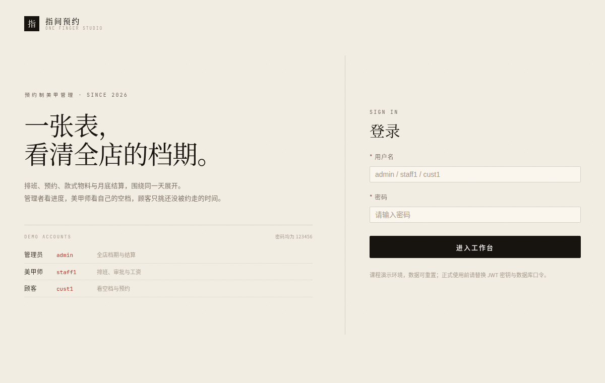

# 预约制美甲管理系统（最小可运行 Demo）

一个面向单店场景的预约制美甲管理系统，覆盖顾客预约、美甲师排班与接单、物料工单、改约、完工上传、服务评价、月底绩效结算。

本项目用于课程设计/答辩演示，采用前后端分离结构，已内置一套可直接演示的种子数据。

- 答辩演示步骤：[docs/DEMO.md](docs/DEMO.md)
- 演示图片素材：[frontend/public/demo](frontend/public/demo)

## 一、技术栈

### 后端

- Java 17
- Spring Boot 3.2.x
- Spring Web
- Spring Data JPA
- Spring Security 6 + JWT
- MySQL 8
- Lombok
- Jakarta Validation

### 前端

- Vue 3
- Vite
- Element Plus
- Axios
- Vue Router
- Pinia

### 约束

- 只用 Spring Data JPA，不使用 MyBatis / MyBatis-Plus；
- 不使用 Redis、MQ、ES、MinIO；
- 列表接口不分页；
- 行级权限在 Service 层通过 `CurrentUserHolder` 判断；
- 所有接口统一为 `{ code, message, data }`。

## 二、功能概览

### 界面预览

三角色共用一套「编辑式」版面：米白纸感、墨黑正文、朱砂强调、宋体标题、发丝分割线；首页是可按月/周切换的档期表。

| 登录 | 管理员 · 月表 | 管理员 · 周表 |
|---|---|---|
|  |  |  |

| 美甲师 · 我的档期 | 顾客 · 看空档再预约 |
|---|---|
|  |  |

### 顾客

- 注册/登录（演示账号已内置）
- 在档期月表里看哪天有美甲师可约，选中日期后直接跳到预约
- 查看美甲师与可预约时段
- 提交预约、取消预约
- 查看已确认、服务中、已完成、爽约预约
- 发起改约、接受/拒绝美甲师改约
- 查看款式工单与完工图
- 对已完成服务提交评价（1–5 星、文字、最多 3 图）

### 美甲师

- 档期月表：哪天在岗、哪天休假、当天有哪些预约
- 维护自己的排班
- 审批/拒绝预约
- 维护款式物料工单、上传效果图
- 发起改约、处理顾客改约
- 开始服务、完成服务、上传完工图
- 标记爽约
- 查看自己的评价与工资结算

### 管理员

- 档期月表 / 周表：一眼看清当天订单、在岗美甲师与每格占用率
- 预约管理、物料准备按「每 3 天一段」切分，点日期段只看这几天
- 查看未来 30 天物料准备清单，按每 3 天一段（今天 / 明天…）切换查看
- 查看全店评价
- 预约管理：撤销爽约、修正已完成预约金额
- 配置薪酬规则
- 生成、确认、撤销月度结算

## 三、目录结构

```text
one_finger_system/
├── backend/
│   ├── pom.xml
│   └── src/main/
│       ├── java/com/nail/demo/
│       │   ├── common/          # 响应体、状态常量、当前用户
│       │   ├── config/          # JWT、安全、上传目录、补数据 Runner
│       │   ├── controller/
│       │   ├── dto/
│       │   ├── entity/
│       │   ├── exception/
│       │   ├── repository/
│       │   └── service/
│       └── resources/
│           ├── application.yml
│           └── db/
│               ├── schema.sql
│               └── data.sql
├── frontend/
│   ├── package.json
│   ├── vite.config.js
│   ├── public/demo/             # 演示用 SVG 图片
│   └── src/
│       ├── api/
│       ├── components/
│       ├── router/
│       ├── store/
│       └── views/
├── docs/
│   ├── DEMO.md                  # 答辩演示脚本
│   └── ...
└── README.md
```

## 四、快速启动

### 1. 环境要求

- JDK 17
- Maven 3.9+
- Node.js 18+
- MySQL 8.0+

### 2. 配置数据库

打开：

```text
backend/src/main/resources/application.yml
```

确认数据库账号密码：

```yaml
spring:
  datasource:
    url: "jdbc:mysql://localhost:3306/nail_demo?createDatabaseIfNotExist=true&useUnicode=true&characterEncoding=utf8&serverTimezone=Asia/Shanghai"
    username: root
    password: "你的密码"
```

数据库无需手动建库，首次启动会自动创建 `nail_demo`、建表并写入种子数据。

### 3. 启动后端

```bash
cd backend
mvn clean package
java -jar target/nail-demo-backend-0.0.1-SNAPSHOT.jar
```

后端默认地址：

```text
http://localhost:8080
```

请从 `backend/` 目录启动，保证上传目录 `./uploads` 与静态映射 `/uploads/**` 一致。

### 4. 启动前端

```bash
cd frontend
npm install
npm run dev
```

访问：

```text
http://localhost:5173/login
```

Vite 已代理：

```text
/api -> http://localhost:8080
/uploads -> http://localhost:8080
```

演示图片 `/demo/*.svg` 由前端 `public/demo` 直接提供。

### 5. 演示账号

| 角色 | 用户名 | 密码 |
|---|---|---|
| 管理员 | `admin` | `123456` |
| 美甲师 | `staff1` | `123456` |
| 美甲师 | `staff2` | `123456` |
| 美甲师 | `staff3` | `123456` |
| 顾客 | `cust1` | `123456` |
| 顾客 | `cust2` ~ `cust4` | `123456` |

## 五、内置演示数据

`data.sql` 会在首次启动时写入一套完整的答辩场景，全部使用固定演示 ID（`9001` 起）和 `INSERT IGNORE`，不会覆盖后续演示过程中产生的数据。

| 预约 ID | 场景 | 用途 |
|---|---|---|
| `9001` | 已完成，680 元，5 星好评 | 完工图、评价、结算 |
| `9002` | 已完成，1280 元，4 星好评 | 好评奖励、结算 |
| `9003` | 已完成，480 元，2 星差评 | 差评扣减、结算 |
| `9004` | 今天 16:00 已确认 | 开始服务、完成服务 |
| `9005` | 明天 10:00 待确认 | 美甲师审批 |
| `9006` | 明天 13:00 改约中 | 顾客接受改约 |
| `9007` | 前天 18:00 爽约 | 爽约统计 |
| `9008` | 昨天 18:00 爽约 | 爽约统计 |
| `9009` | 今天 15:00 爽约 | 管理员撤销爽约 |

同时内置：

- 今天、明天的排班和时间槽；
- 已完成/已确认/改约中预约的款式工单；
- 3 条评价（2 好评、1 差评）；
- 明天 15:00 的待处理改约提案；
- 美甲师薪酬规则：底薪 3500、提成 30%、好评 +50、差评 -100。

### 档期月表演示数据

`data.sql` 末尾还有一段以 `CURDATE()` 为基准的档期数据，用来让首页月表不空：

- 三位美甲师（小王 09:00–18:00、小陈 10:00–19:00、小周 11:00–20:00），各自不同的休息日，并各安排一天调休；
- 本月整月的排班、按 15 分钟展开的时间槽，以及每天 1–3 条预约；
- 今天已确认预约的款式工单，供“今日物料”直接演示；
- 本月内不写入 `COMPLETED` / `NO_SHOW` 预约，因此上面的 `4202` 结算口径不受影响。

这段数据同样使用 `CURDATE()` 相对日期与固定主键，重复执行不会重复插入。

### 初始结算口径

首次生成当前月份结算时，预期为：

```text
完成单数：3
总营收：680 + 1280 + 480 = 2440
提成：2440 × 30% = 732
好评：2 条，奖励 100
差评：1 条，扣减 100
评价调整：0
爽约：3 次，扣款 floor(3 / 3) × 30 = 30
底薪：3500
最终工资：3500 + 732 + 0 - 30 = 4202
```

管理员撤销 1 条爽约后重新生成：

```text
爽约：2 次，扣款 0
最终工资：4232
```

完成 9004（金额 880）并由顾客提交 5 星好评后重新生成：

```text
完成单数：4
总营收：3320
提成：996
好评：3 条，奖励 150
差评：1 条，扣减 100
爽约：2 次（已撤销 1 条），扣款 0
最终工资：3500 + 996 + 50 = 4546
```

## 六、答辩演示

完整点击路径、讲解词和时间分配见：

**[docs/DEMO.md](docs/DEMO.md)**

建议演示顺序：

1. 管理员：今日物料 → 评价 → 预约管理 → 薪酬规则 → 月度结算；
2. 管理员：生成结算 4202、确认结算；
3. 管理员：撤销 1 条爽约，撤销结算后重新生成 4232；
4. 美甲师：我的工资 → 审批待确认 → 开始/完成今日服务；
5. 顾客：接受改约 → 查看完工图 → 提交评价；
6. 管理员：重新生成结算，展示 4546。

## 七、重置演示数据

当前种子数据只在首次插入时生效，演示过程中产生的预约、评价、结算会保留。

如果需要恢复到初始答辩状态，**仅限演示数据库**：

```bash
mysql -uroot -p -e "DROP DATABASE IF EXISTS nail_demo;"
```

然后重启后端，`schema.sql` 和 `data.sql` 会重新建库、建表并写入种子数据。

> 该操作会删除整个 `nail_demo` 数据库，请勿在真实数据环境执行。

## 八、配置说明

### 上传目录

`application.yml`：

```yaml
app:
  upload-dir: ./uploads
```

上传文件限制：

- 单张 5MB；
- 请求 6MB；
- 支持 jpg、jpeg、png、webp；
- 返回 `/uploads/{uuid}.{ext}`。

### JWT

```yaml
jwt:
  secret: "nail-demo-secret-key-please-change-123456"
  expiration-hours: 24
```

生产环境必须替换 secret。

### 数据库初始化

```yaml
spring:
  sql:
    init:
      mode: always
```

- `schema.sql` 使用幂等建表；
- 阶段 6 的 `no_show_exempt`、`review.sentiment` 使用 `information_schema` + 动态 SQL 兼容旧库；
- `data.sql` 使用 `INSERT IGNORE`，重复执行不会重复插入种子数据。

## 九、已知限制

- MVP 只支持单店、单角色单账号；
- 没有支付、退款、发票；
- 没有分页；
- 薪酬规则不做版本化，`effective_from` 仅记录日期，未结算月份统一使用当前 ACTIVE 规则；
- 月度结算为手动触发，不做定时自动结算；
- 评价不做修改、删除、回复和审核；
- 完工图/评价图上传是独立文件上传，然后随业务表单提交 URL；
- 演示图片为 `public/demo` 下的 SVG 占位素材，真实上传仍只允许 jpg/jpeg/png/webp。

## 十、常见问题

### 1. 登录 401

- 确认后端已启动；
- 确认 `Vite` 代理 `/api` 指向后端端口；
- 清除浏览器 localStorage 后重新登录。

### 2. 中文乱码

确认数据库、连接和页面均为 utf8mb4：

```sql
SHOW VARIABLES LIKE 'character_set_database';
```

### 3. 上传后图片 404

- 确认后端从 `backend/` 目录启动；
- 确认 `uploads` 目录可写；
- 确认 Vite 已代理 `/uploads`。

### 4. 结算金额不是预期

- 检查当前月份是否选对；
- 检查评价是否属于目标月完成预约；
- 检查爽约是否已豁免；
- 已 SETTLED 的记录不会自动变化，需要先撤销再重新生成；
- 演示前可执行“重置演示数据”。

### 5. 种子数据没有出现

- 种子使用固定 ID，若数据库已存在同 ID 记录会被忽略；
- 确认 `spring.sql.init.mode=always`；
- 如需干净演示，按“重置演示数据”操作。
