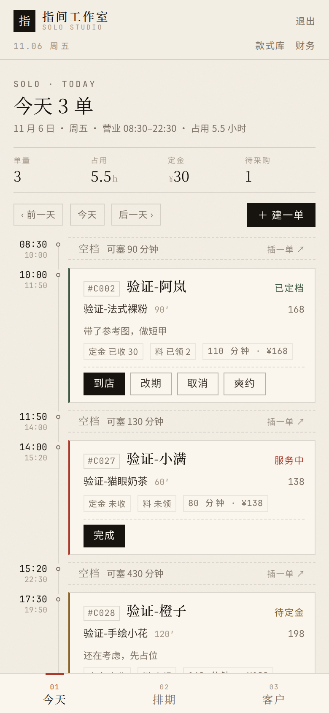

# P3 · 前端骨架与今日作业单

> 分支 `feat/solo-studio`；事实来源 `docs/solo/00-brief.md`。
> 本轮范围：单人版前端骨架（路由 `/solo/*`）+「今日作业单」+ 建单抽屉。移动优先，390px 验收。

## 1. 交付物位置

| 内容 | 路径 |
|---|---|
| 路由与登录落地页 | `frontend/src/router/index.js`、`frontend/src/views/Login.vue` |
| 外壳（报头 + 底部三入口） | `frontend/src/views/solo/SoloLayout.vue` |
| 今日作业单 | `frontend/src/views/solo/SoloToday.vue` |
| 作业单卡片 | `frontend/src/components/solo/BookingCard.vue` |
| 建单 / 改期 / 通用底部抽屉 | `frontend/src/components/solo/BookingCreateSheet.vue`、`RescheduleSheet.vue`、`SoloSheet.vue` |
| 排期 / 客户 / 款式 / 财务占位 | `frontend/src/views/solo/Solo*.vue`、`SoloPlaceholder.vue` |
| 接口封装 | `frontend/src/api/solo.js` |

复用既有设计系统：`styles/tokens.css` 的纸面 / 墨黑 / 朱砂，`base.css` 的编辑式排版语法；没有引入新依赖。

## 2. 页面结构

```
/solo                      → 重定向 /solo/today
/solo/today                今日作业单（本轮完整实现）
/solo/schedule             排期（P4，占位）
/solo/clients              客户（P5，占位）
/solo/styles               款式库（P5，占位，二级）
/solo/finance              财务（P6，占位，二级）
```

导航形态：底部三入口「今天 / 排期 / 客户」；款式库与财务降为报头下方一行小字（二级），不占底部位置。
所有 `/solo/*` 路由要求 `ADMIN` 角色；管理员登录后直接落到 `/solo/today`（多角色页面仍保留在路由中，答辩用 `main` 分支）。

## 3. 今日作业单

| 区块 | 内容 |
|---|---|
| 抬头 | `今天 N 单` + 单量 / 占用小时 / 定金合计 / 待采购件数 + 营业时段 |
| 时间轴 | 默认 8:30–22:30，按当天营业段裁剪；空档一行显示「可塞 N 分钟」并可点「插一单」直接带时间建单 |
| 卡片 | 时间与时长（左侧时间柱）、`#短号 + 昵称`、款式缩略图、项目列表、定金状态、领料情况、备注、连做/插队标记 |
| 卡片操作 | 到店 / 开始 / 完成 / 收定金 / 改期 / 取消 / 爽约（按状态给小动作集） |
| 提醒 | 折叠区：今日未开始 + 明日预约，每条一句话术 + 一键复制 |
| 建单抽屉 | 搜客户（或回车快速建档）→ 选款式（可多选连做）→ 日期时间 + 缓冲 → 备注 → 勾选收定金 → 保存 |



## 4. 设计取舍

1. **时间轴用紧凑流水，不用按比例的长条**。真按 8:30–22:30 比例画，一天 14 小时、4 单，390px 下要滚三屏才看完；改成「时间柱 + 卡片 + 空档单行」，当天单量在一屏能数清，空档也仍然看得见可塞多久。
2. **待采购件数取「还没备好的料」**：`TODO / ORDERED / SHIPPING` 三种采购状态的库存件数。比「今天要用几件」诚实——现在的数据模型里，款式材料清单还没和库存建关联，硬算「今天的料」会编数据。
3. **卡片上写「料 已领 2 / 未领」而不是「物料是否齐」**：「齐不齐」需要 BOM 对照，属于 P6 的库存+采购聚合；现在能给的真话是「这单领了几件料」。
4. **提醒只提醒老板，且只发还没到点的单**。今天已过点的单不再是「要发的提醒」；昨日未确认那类依赖 P7 的提醒接口，本轮没做。
5. **冲突不静默**：建单撞档时把后端 409 返回的冲突单摘要摊在抽屉里，显示「谁的单、几点到几点」。

## 5. 接口对应

| 页面动作 | 接口 |
|---|---|
| 读当天排期 | `GET /api/solo/schedule/day?date=` |
| 建单 / 收定金 | `POST /api/solo/bookings`、`POST /api/solo/bookings/{id}/deposits` |
| 到店 / 开始 / 完成 / 爽约 | `POST /api/solo/bookings/{id}/arrive|start|complete|no-show` |
| 改期（含需扣定金三选一） | `POST /api/solo/bookings/{id}/reschedule` |
| 取消 / 退定 | `POST /api/solo/bookings/{id}/cancel` |
| 客户搜索与快速建档 | `GET/POST /api/solo/clients` |
| 款式选择 | `GET /api/solo/styles?enabled=1` |
| 领料情况 | `GET /api/solo/bookings/{id}/materials` |

本轮对后端只加了一个字段：`DayScheduleResponse.Stats.purchasePending`（统计待采购件数），对应 `MaterialItemRepository.countByPurchaseStatusIn`。

## 6. 验证（390×844，Chromium headless + CDP）

流程：登录态注入 → 打开 `/solo/today` → 量横向溢出 → 建单抽屉里走一遍「搜客户 → 选款式 → 定 12:00 → 保存」→ 新单依次点「到店 / 开始 / 完成」→ 再点一遍三个主入口与两个二级入口。

```
PASS  今日作业单渲染 — 今天 3 单
PASS  390px 无横向滚动 — scrollWidth=390 innerWidth=390 溢出元素=[]
PASS  三单都渲染出来 — 卡片数=3
PASS  空档显示可塞分钟 — 可塞 90 分钟 | 可塞 130 分钟 | 可塞 430 分钟
PASS  提醒清单可展开 — 条目=1
PASS  建单抽屉打开
PASS  搜索并选中客户 — #C028 验证-橙子
PASS  选中款式 — 验证-猫眼奶茶 60′ · 138
PASS  建单后卡片 +1 — 3 → 4
PASS  点「到店」 — 按钮=到店
PASS  点「开始」 — 按钮=开始
PASS  点「完成」 — 按钮=完成
PASS  完成后状态为已完成 — 已完成
PASS  时间轴一屏装得下 — 时间轴 691px / 视口 844px
PASS  整天的单都在同一页、无分页 — 卡片 4 张，首屏完整可见 3 张
PASS  底部入口「排期」 — 排期
PASS  底部入口「客户」
PASS  二级入口「款式库」
PASS  二级入口「财务」
PASS  回到今天 — 今天 4 单
合计 20 项，失败 0 项
```

截图（390px，2x）：

| 页面 | 图 |
|---|---|
| 今日作业单（3 单 + 空档） | `docs/screenshots/solo-today.png` |
| 提醒折叠区 | `docs/screenshots/solo-reminders.png` |
| 建单抽屉 | `docs/screenshots/solo-create-sheet.png` |
| 走完「到店 → 完成」后 | `docs/screenshots/solo-completed.png` |
| 二级页占位（排期） | `docs/screenshots/solo-placeholder.png` |

### 复跑方法

```bash
# 1. 起后端（本机 ~/.m2 只读，加锁开关）
cd backend
mvn -B -Dmaven.repo.local=target/m2repo -Daether.syncContext.named.factory=noop spring-boot:run

# 2. 灌演示数据（3 客户 / 3 款式 / 今天 3 单：已定档+已收定金 / 服务中 / 待定金，外加一单领料）
bash target/seed-p3.sh

# 3. 起前端
cd ../frontend && npm run dev -- --port 5173 --host 127.0.0.1

# 4. 起 headless Chromium 并跑 CDP 脚本（Node 内置 WebSocket，不装 playwright）
chromium --headless=new --no-sandbox --remote-debugging-port=9222 \
  --user-data-dir=/tmp/chrome-p3 --window-size=390,844 about:blank &
node target/verify-p3.mjs
```

`target/` 下的两个脚本（`seed-p3.sh`、`verify-p3.mjs`）是本地验收工具，不入库；命令与断言口径都在上面。

## 7. 本轮未做

- 排期页（P4）：周视图、插队、顺延预览
- 客户档案与款式库（P5）：目前只有建单时的搜索与快速建档
- 物料与财务页面（P6）
- 提醒的「昨日未确认」部分、话术模板自定义（P7）
- 空档里的「机动位」：`solo_slot_block` 已支持 `FLEX`，但设置页在 P7，本轮只按营业段裁剪
