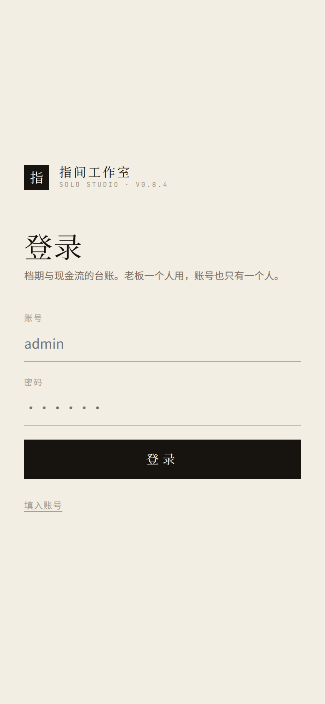
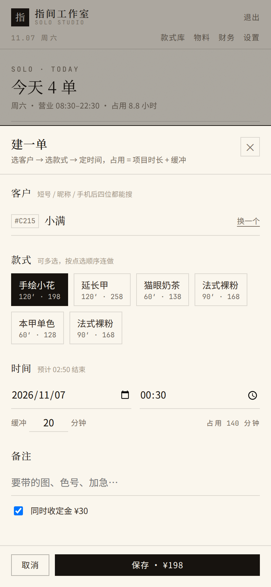
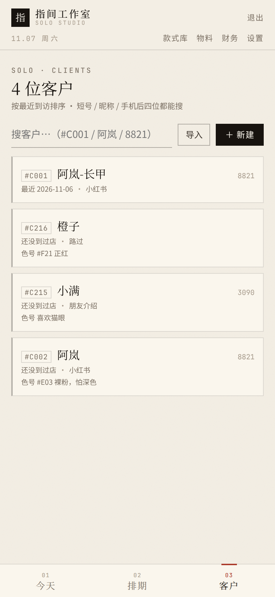
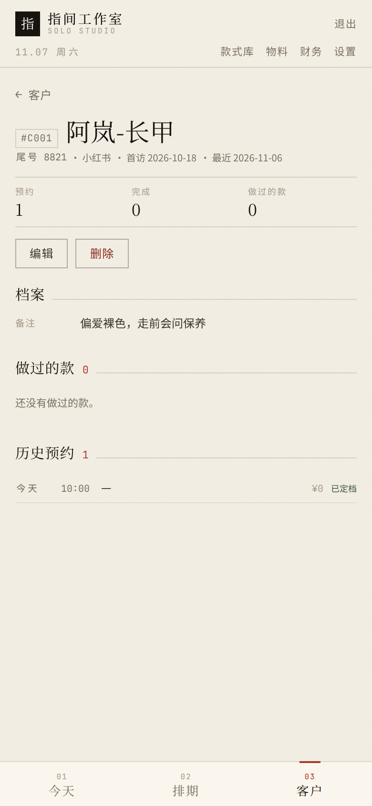
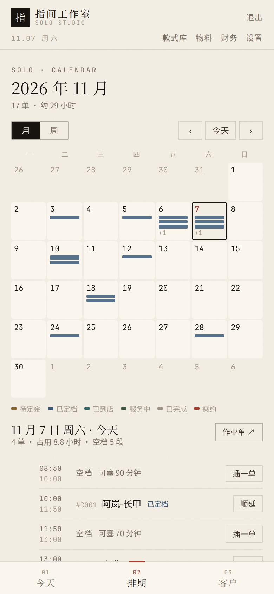
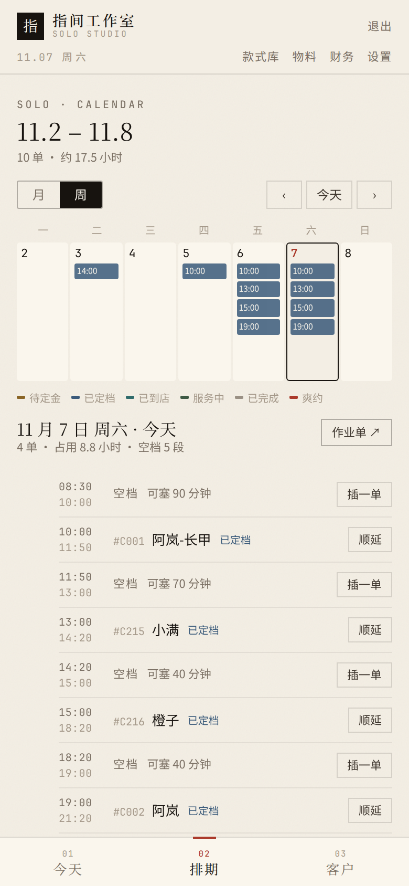
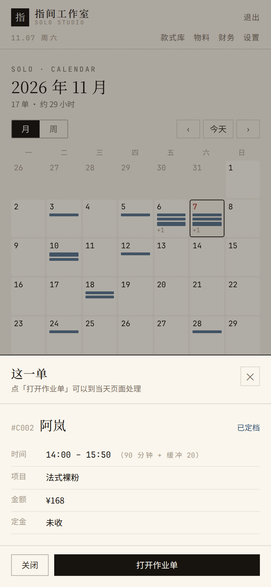
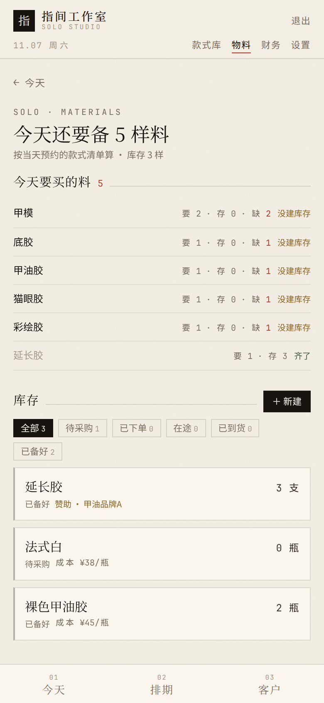
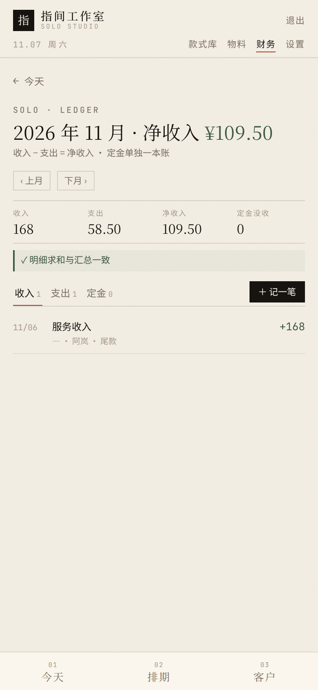
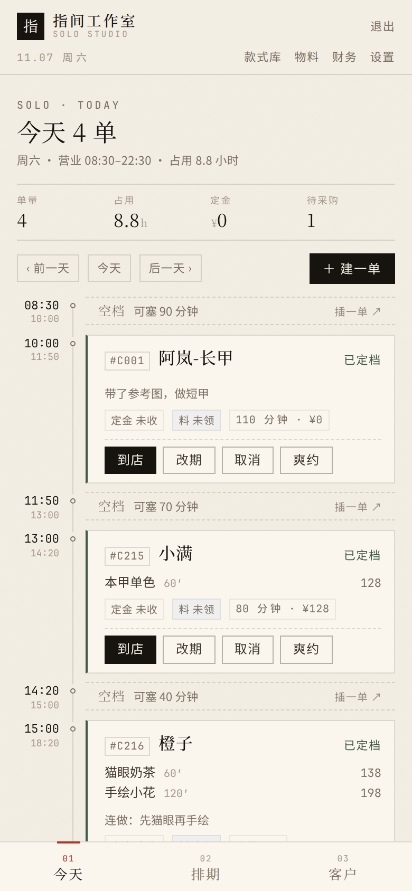

# 指间工作室 · 使用说明书

> 给美甲师自己看的一本说明。不用懂电脑，照着点就行。
> 遇到不认识的词，最后一节有对照表。

## 这套系统是干什么的

一句话：**把你脑子里的排期表、微信里的定金记录、抽屉里的材料单，放进一个地方。**

它只帮你盯四件事：

1. **今天给谁做、做什么款、几点到几点**（不撞档、不漏人）
2. **材料够不够**（当天要用的料，缺什么一目了然）
3. **定金收没收、该不该退**（每一笔都有记录）
4. **这个月赚了多少**（收入、支出、净收入，对得上账）

它**不会**做的事，先说清楚，免得你等功能：不会替你发微信、不会在线收款、客人没有账号、不会自动排班。

> 文里说的「装系统的人」，就是帮你在服务器上装好这套东西的那个人。
> **很可能就是你自己**（如果你是按说明自己装的），那就把「找装系统的人」理解成「把这事记下来，回头在电脑上处理」。

---

## 目录

- [一、第一次打开](#一第一次打开)
- [二、先认清这几样（配图）](#二先认清这几样配图)
- [三、正式用之前：先建几个常用款](#三正式用之前先建几个常用款)
- [四、建单：3 分钟排进一单](#四建单3-分钟排进一单)
- [五、一天的流程（最常用）](#五一天的流程最常用)
- [六、定金：收了以后可能出现的三种结局](#六定金收了以后可能出现的三种结局)
- [七、客户档案](#七客户档案)
- [八、看日历、插单、往后顺延](#八看日历插单往后顺延)
- [九、材料：今天要买什么、这单用了什么](#九材料今天要买什么这单用了什么)
- [十、算账](#十算账)
- [十一、每天三组要发的微信](#十一每天三组要发的微信)
- [十二、改自己的账号和密码](#十二改自己的账号和密码)
- [十三、手机和电脑](#十三手机和电脑)
- [十四、出问题了怎么办](#十四出问题了怎么办)
- [十五、一页速查（建议截图存手机）](#十五一页速查建议截图存手机)
- [附录：名词对照](#附录名词对照)

---

## 一、第一次打开

### 在手机上打开

用手机自带的浏览器（Safari、Chrome 这类），在地址栏输入装系统的人给你的网址，形如：

```
http://115.190.195.217
```

- 这串数字**一个都不能错**，错一位就打不开。建议让装系统的人把它做成二维码发给你，扫码直接进。
- 手机上可以把网址「添加到主屏幕」（Safari：分享 → 添加到主屏幕；安卓 Chrome：右上角三个点 → 添加到主屏幕），以后像 App 一样点开。

### 登录



| 要填的 | 填什么 |
|---|---|
| 账号 | `admin`（如果改过登录名，就填新的） |
| 密码 | 装系统的人给你的那一串 |

点「**登录**」。

> **账号只有一个**。这套系统没有员工账号、没有客户账号，整台机器就是你一个人用。
> 右上角有「**退出**」，用别人的手机登过，记得退出。

### 进去以后

直接落在「**今天**」这一页。今天还没排单的话，会显示「今天还没有单 · 点「建一单」把第一单排进去」。

---

## 二、先认清这几样（配图）

### 1. 底部三个入口

手机上，屏幕最下面永远有这三个，点一下就切换：


| 入口 | 里面是什么 |
|---|---|
| **今天** | 今天的排期，一单一单排下来，中间的空当写着「可塞 N 分钟」 |
| **排期** | 日历。可以按月看，也可以按周看，有单的日子会显示彩色横条 |
| **客户** | 你所有的客人，按「最近到访」排序 |

### 2. 顶部四个入口

屏幕上那条标题栏下面横着四个：**款式库 · 物料 · 财务 · 设置**。

这四个平时不常点，是有事才去的地方。点进去后，左上角有「**← 返回**」（有的页面直接写「**← 今天**」），点它回到上一层。

### 3. 一单长什么样


每一单是一张卡片：

```
┌──────────────────────────────────────┐
│ #C002  阿岚                 已定档   │   ← 短号、名字、状态
│ 法式裸粉  90'                 168    │   ← 做了什么款、多久、多少钱
│ [定金 已收] [料 未领]  110 分钟 · ¥168 │  ← 标签 + 共占时间
│ [到店] [改期] [取消] [爽约]          │   ← 现在能做的操作
└──────────────────────────────────────┘
```

- **短号**（`#C002`）：系统给每个客人编的号，几个字就能搜到人
- **两个方框标签**：`定金` 和 `料`
  - 定金：`未收` / `已收` / `已退` / `已没收`
  - 料：`未领` / `已领 2`（数字＝这一单领了几样料）
- 右边那串文字：**共占多少分钟**（做活 + 缓冲）· **这单收多少钱**

### 4. 卡片上的按钮会变

这点最容易懵：**同一张卡片，在不同阶段按钮不一样。**

| 卡片状态 | 你能点的按钮 |
|---|---|
| 待定金 | 收定金 · 改期 · 取消 · 爽约 |
| 已定档 | 到店 · 改期 · 取消 · 爽约 |
| 已到店 | 开始 · 改期 · 取消 |
| 服务中 | 完成 |
| 已完成 / 已取消 | 没有按钮了，只剩记录 |

所以：**点过「到店」才会冒出「开始」，点过「开始」才会冒出「完成」。** 顺序不能跳。

---

## 三、正式用之前：先建几个常用款

**为什么先做这一步**：建单时要选款式，而款式得先有。把常做的几个款建进去，以后建单就是点两下的事。

### 怎么建

1. 顶部点「**款式库**」
2. **右上角**点「**＋ 新建**」
3. 填这几项：

| 项目 | 怎么填 | 例子 |
|---|---|---|
| **名称** | 客人听得懂的名字 | 法式裸粉 |
| **封面** | 选填，可以后补。用手机拍照上传 | — |
| **标准时长** | 大概做多久，填**分钟** | 90 |
| **标准价** | 一般收多少，填**元** | 168 |
| **标签** | 选填。填 `法式,裸色`（逗号用**英文逗号**：手机上把输入法切到英文再打） | 法式,裸色 |
| **材料清单** | 选填，**每行一项**，只写名字 | 底胶<br>法式白 |

4. 点「**保存**」

建好后卡片会显示「90'」「¥168」，点开能改。

> 材料清单里**不用写用量**——系统按「这一天有哪些单、每单要哪些料」去和库存比，算出还缺几样。

### 想给客人看作品图

「款式库」里点「**导出案例图**」：

1. 可以点标签筛（不选＝所有建好的款，最多 9 款）
2. 等一下，下面自动出一张**竖版九宫格**预览
3. 点「**保存图片**」

iPhone 存进「照片」，安卓一般存进「相册 / Pictures」。图是 1080×1440、带水印，可以直接发朋友圈或小红书。

---

## 四、建单：3 分钟排进一单

在「**今天**」页**右上角**点「**＋ 建一单**」，屏幕下方弹出一个输入面板，从上往下一项项填。



### 第 1 步：找人

- 在「客户」输入框里输**昵称、短号或手机后四位**，都能搜到
- 点中客人就选上了（右边会变成「换一个」）
- **第一次来的新客人**：在框里输她的昵称，然后按手机键盘右下角那个键（显示为「**前往**」「**搜索**」「**完成**」或 `↵`，不同手机不一样）。
  按完这一下，系统就当场给她建好档案。

> 这是接第一个新客的必经动作。按完没反应，说明昵称还没输进去，或者键盘上那个键是「换行」——换个输入法再试。

### 第 2 步：选题

- 点款式卡片选中，**可以点多张**
- 多选的顺序就是做活的顺序（先做第一张，再做第二张），这叫**连做**
- 下面的「预计 → 结束」会跟着变，已经算上了缓冲

### 第 3 步：定时间

- **日期**：点日期那一栏会弹出日历，选哪天
- **开始时间**：点时间那一栏，上下滚动选时间
- **缓冲**：默认 20 分钟，是留给收拾台面、送客的间隙。可以改小，也可以填 0
- **占用**：系统自己算（做活时间 + 缓冲），你不用算

> 缓冲**不建议填 0**：填 0 之后两单紧挨着，前面一拖，后面立刻撞档。

### 第 4 步：备注

写点有用的：`怕深色`、`带了参考图`、`加急`、`朋友介绍`。

### 第 5 步：收定金（这单要收才勾）

勾上「**同时收定金**」，金额是**设置里定好的**（默认 30 元）。

> 这个金额**不能在这一单上改**。要改，去「设置 → 营业与规则 → 定金」改全店默认值。

### 第 6 步：保存

点「**保存**」。面板收起，回到你今天看的那一页。

> **如果排的是别的日子**：保存后页面还停在今天，看不到那单是正常的。
> 点「今天」页上方的「**后一天 ›**」，或者去「**排期**」页翻到那一天。

### 如果时间撞了

系统会拦住，并告诉你撞上了哪一单：

```
撞上的单：15:00 #C003 小满 法式裸粉
[取消]  [仍然强排（作业单里会标红）]
```

- **大多数情况点「取消」**，换个时间
- 确实要接（客人加急、你决定两单并着做），才点「**仍然强排**」。
  强排之后这两单会标红，页面顶部提示「⚠ 2 单时段冲突，已标红」——提醒你自己心里有数

---

## 五、一天的流程（最常用）

### 早上：看一眼今天

打开「**今天**」，从上往下就是当天的时间表：

```
08:30 ─ 空档 可塞 90 分钟     插一单 ↗
10:00 ─ #C002 阿岚 法式裸粉    已定档     ← 90 分钟活 + 20 缓冲，11:50 结束
11:50 ─ 空档 可塞 430 分钟    插一单 ↗
19:00 ─ #C216 橙子 猫眼奶茶    已定档
```

- 「**空档 可塞 N 分钟**」＝ 从上一单结束到下一单开始，中间还剩多久
- 空当**够放下一单**时，右边才会出现「**插一单 ↗**」，点它直接建在这个空当里
- 最上面四个数字：**单量 / 占用 / 定金 / 待采购**
  ＝ 今天几单 · 一共占多少分钟 · 定金收了多少 · 还缺几样料

**想看别的日子**：页面上方有「**‹ 前一天**」「**今天**」「**后一天 ›**」，点它们来回翻。

### 客人来了

卡片上点「**到店**」，状态从「已定档」变成「已到店」。

### 开始做

点「**开始**」，变成「服务中」。

### 做完了

点「**完成**」，状态变成「已完成」。

> **完成 ≠ 收到钱。** 这一步只更新客人的到访记录和「做过的款」。
> 尾款要另外去「财务 → 记一笔」记（见第十节）。

### 客人没来

点「**爽约**」。如果这单收过定金，系统会问你定金怎么办（见下一节）。

---

## 六、定金：收了以后可能出现的三种结局

定金是**锁住这个时间段**用的。收了之后计划有变，只有三种走法。

### 走法一：改期

点卡片上的「**改期**」，填「**新的开始时间**」（日期和时间都能改，跨天也行）和「原因」，保存。

系统会自己判断**要不要扣定金**：

| 情况 | 结果 |
|---|---|
| 离开始还有 **48 小时以上**，并且**这一单**没用过免费改期 | 直接改，不问你 |
| 不足 48 小时，或者这一单的免费改期已经用过 | 弹出来让你选下面三个 |

- **退定金并改期**——钱退给客人，时间改成新的（系统记一笔「定金退还」，卡片标签变成 `已退`）
- **没收定金并改期**——钱不退，时间改成新的
- **仍然免费改期**——钱不动，时间改成新的（你自己决定这次算了）

> 「48 小时」可以在「设置 → 营业与规则 → 免费改期阈值」里改。
> **免费改期是「每一单各有一次」**；用掉了这一单的，这单再改就要你选上面三个。

改完如果还没告诉客人，排期页的「**待通知清单**」会记着。

### 走法二：取消

点「**取消**」，填原因。如果这单收过定金，会问你定金怎么办：

- **退还定金**——客人有理（临时生病、你自己有事）
- **没收定金**——客人临时放鸽子又不改期
- **先不动**——事情还没定，先挂着

### 走法三：爽约

点「**爽约**」。爽约通常意味着定金不退（没收），也可以选择退。

### 一句话记住

> **定金只在「收」和「退 / 没收」这两个动作时才会动。**
> 系统不会自动扣、也不会自动退，每一步都要你点。

---

## 七、客户档案

### 找客人

底部点「**客户**」。最上面是搜索框，输**昵称、短号、手机后四位**都能搜到。



列表默认按「**最近到访**」排序——常来的老客在上面。

### 第一次来的客人

两种办法：

1. 建单时直接在搜索框输昵称，**按键盘右下角那个键**，当场建档（最快）
2. 或者「客户」页**右上角**点「**＋ 新建**」，填：

| 项目 | 说明 |
|---|---|
| **昵称** | 必填。建议带区分词，如「阿岚-长甲」 |
| **手机后四位** | 选填 |
| **来源** | 选填：小红书 / 朋友介绍 / 路过 / 老客 |
| **常用色号** | 选填，但**很值得填**：`#E03 裸粉，怕深色`、`不喜欢亮片` |
| **备注** | 选填 |

> 昵称和已有客人重名时，系统会提示「已有同名客户，建议加个区分词」。
> 它**不会拦着你保存**——两个小满很正常。

### 看一个客人

在列表里点她的名字：



```
#C002  阿岚
尾号 9911 · 小红书

预约 6    完成 5    做过的款 4

[编辑]  [删除]

做过的款 4
[法式裸粉 ×2] [猫眼奶茶 ×1] [延长甲 ×1] [手绘小花 ×1]

历史预约 6
今天     10:00  法式裸粉        ¥168  已定档
10/28    13:00  猫眼奶茶        ¥138  已完成
```

- 「**做过的款**」——她做过什么，重复做的时候参考
- 「**历史预约**」——每次的时间、款式、金额、状态

### 删除客人

点「**删除**」，确认框会说明：

> 删除后客户不再出现在列表和搜索里，但历史预约、定金与流水都会保留，账目不会断。

删掉的只是「这个人」，账不会消失。她的历史单子上会显示成「**客户已删除**」，金额、定金、流水都还在。

> 删错了没有「撤销」。重新建一个同名客户，**不会**把旧记录接上——新档案是空的，看不到她以前的「做过的款」。
> 所以删之前想一下：只是不想再看到，还是真的要清掉。

---

## 八、看日历、插单、往后顺延

### 看日历

底部点「**排期**」。左上角可以切换「**月**」和「**周**」：



- **月视图**：一整个月的格子，有单的日子会显示**彩色横条**，条数多就变成「+1」「+2」
- **周视图**：7 列，每根横条上写着开始时间



**颜色代表这一单到哪一步了**，图例就在日历下面：

| 颜色 | 意思 |
|---|---|
| 琥珀色 | 待定金 |
| 深蓝色 | 已定档 |
| 青色 | 已到店 |
| 墨绿色 | 服务中 |
| 灰色 | 已完成 |
| 红色 | 爽约 |
| 斜纹 | 已取消（不占档期） |

左右两个「**‹**」「**›**」翻月 / 翻周，中间「**今天**」一键回到本月（周）。

### 看某一天的详情

点日历里任意一格，下面就会展开那天的明细（空档 + 预约）。
或者直接点某一根**彩色横条**，会弹出这一单的信息：



```
#C002  阿岚                    已定档
时间   14:00 – 15:50（90 分钟 + 缓冲 20）
项目   法式裸粉
金额   ¥168
定金   未收
[关闭]  [打开作业单]
```

点「**打开作业单**」就跳到那天，可以改时间、收定金、点完成。

### 插单（临时来了个客人）

点「**插一单 ↗**」——只有在**空当够长**的时候才会出现这个按钮。
点进去填的跟建单一样，系统会自己检查塞不塞得下。

### 往后顺延（今天做不完了）

比如前一个客人拖了 30 分钟，后面几单都要往后挪。

1. 在**排期页的当天明细**里，找到**要挪的第一单**，点它旁边的「**顺延**」
   （用它当起点，它之前的单不动——已经做完的不会被推走）
2. 在弹窗里选「挪多久」：30 / 60 分钟，或者「自定义」
3. 系统先算给你看：**影响 N 单**，确认没问题
4. 点「**确认顺延**」

顺延只挪**这一单及其之后**的预约。

### 发完微信记得标记

顺延之后会生成一份「**待通知清单**」——因为**系统不会自动通知客人**。

1. 在**排期页**往下找「**待通知清单**」（标题旁边有数字＝还没发几条）
2. 点每条右边的「**复制话术**」，切到微信贴出去
3. 发完回来点「**已发微信**」，这条就从清单里消失

---

## 九、材料：今天要买什么、这单用了什么

### 今天要买什么

顶部点「**物料**」，最上面一块：



```
今天还要备 2 样料
按当天预约的款式清单算
```

它会看**今天所有预约**用到的款式材料，再和你的**库存**比：

| 显示 | 意思 |
|---|---|
| 要 1 · 存 0 · 缺 1 | 今天要用 1 样，库存没有，**得买** |
| 要 2 · 存 5 | 够用 |
| 右边标「齐了」 | 够，而且已经备好 |

> 前提是**款式里填了「材料清单」**。没填的话这里会提示：
> 「今天的款式没登记材料清单 → 在「款式库」里给款式填上材料」。

### 记这单用了什么料

**不用去物料页**。在「今天」页找到那一单，点卡片上的「**料 未领**」：

1. 选物料（会显示库存还剩多少）
2. 填数量
3. 确认

系统会**当场扣库存**，并记下这单的材料成本（算进支出）。标签随即变成「**料 已领 2**」，点它还能再补。

> **注意**：这个面板只能**选已经建好的物料**，不能在这里新建。
> 新买的胶还没录进系统？先去「物料 → 右上角 ＋ 新建」录一条，再回来领。
>
> 赞助来的材料（品牌送你用的），成本记 0，但可以填「赞助商」和「赞助价值」——账上不把送的算成花钱。

### 管库存

「物料」页下半部分是库存列表，可以按采购状态筛：待采购 / 已下单 / 在途 / 已到货 / 已备好。

点任何一个能改：名称、单位、单位成本、是否赞助、赞助商、赞助价值、采购状态、备注。

---

## 十、算账

顶部点「**财务**」。



### 每个月的样子

```
2026 年 11 月 · 净收入 ¥109.50
收入 168 | 支出 58.50 | 净收入 109.50 | 定金没收 0
✓ 明细求和与汇总一致
```

| 数字 | 意思 |
|---|---|
| **收入** | 这个月收到的钱（尾款等） |
| **支出** | 这个月花出去的钱（买材料等） |
| **净收入** | 收入 − 支出 |
| **定金没收** | 这个月没收的定金总额（**定金单独一本账，不算进收入**） |

> **为什么我微信真收了 30 块定金，收入却是 0？**
> 因为定金不是收入，它可能还要退回去。定金单独记在「定金」那本账里，只有「没收」的才计入本月那个「定金没收」数字。
> 真正的收入是**你做完活收的尾款**。

那行「**明细求和与汇总一致**」是系统自己核对的：

- 一致 → 出现 ✓，正常
- 出现「**汇总与明细不一致**」→ 有数据对不上，**别慌**，先记下是哪个月，找装系统的人看

### 记一笔

点「**＋ 记一笔**」：

| 项目 | 说明 |
|---|---|
| **方向** | 收入 / 支出 |
| **类别** | 收入：服务收入、其他　支出：物料支出、其他 |
| **金额** | 数字 |
| **日期** | 默认今天。**补记以前的就改成那一天**，它会算进那个月 |
| **备注** | 写清楚：`阿岚 尾款`、`补两瓶胶` |

> **做完一单记得来记尾款。** 系统不会因为你点了「完成」就自动算收入——实际收了多少钱，只有你知道。

### 三本账

往下是三条明细：**收入 / 支出 / 定金**，分开记。有对应预约的，点一下能跳回那天。

### 导出（交给会计）

「设置 → 导出」，三个按钮：

| 按钮 | 里面是什么 |
|---|---|
| **客户 CSV** | 所有客人的档案 |
| **预约 CSV** | 所有预约（含日期、金额、状态） |
| **流水 CSV** | 所有收支和定金 ← **给会计用这个** |

下载下来用 Excel / WPS 打开就是表格。

> 导出的是**全部历史**，不是某一个月。要某个月的，在 Excel 里按「日期」那一列筛一下。

---

## 十一、每天三组要发的微信

「今天」页最下面有个折叠区「**今天要发的提醒**」，点开：



```
昨日未确认 1
  昨天 10:00  #C002 阿岚
  Hi 阿岚，昨天 10:00 的档期没等到你，还好吗？想改天的话我帮你重新排～
  [复制话术]

今天 2
  今天 15:00  #C003 小满
  Hi 小满，提醒一下今天 15:00 到店做法式裸粉，档期给你留着…
  [复制话术]

明天 1
  明天 11:00  #C005 橙子
  Hi 橙子，明天 11:00 的档期先给你留着，定金 30 转我，这个时间就给你留死～
```

| 组 | 是谁 | 为什么要发 |
|---|---|---|
| **昨日未确认** | 昨天没到、也没取消的客人 | 问一句「还好吗」，顺便改约，别丢客户 |
| **今天** | 今天还没到店的 | 提醒到店。已过点的，话术自动变成「现在过来还来得及」 |
| **明天** | 明天有约的 | 提前确认，**还没交定金的尤其要发**（话术自动带定金金额） |

用法就一步：点「**复制话术**」，切到微信粘贴发出去。

> 系统只帮你把话说好，**发还是要你自己发**。

---

## 十二、改自己的账号和密码

顶部「**设置**」→ 最上面「**账号**」。

| 想改 | 怎么做 |
|---|---|
| 登录名 | 填「新登录名」 |
| 密码 | 填「新密码」+「确认新密码」（至少 8 位） |

**当前密码一定要填**，这是防止别人拿你手机直接改掉。

改完系统会**自动退回登录页**。请立刻用新账号密码登录一次，登上了再关掉这一页。

> 忘了密码自己救不回来，需要有人在服务器上改。所以：改密码那天，把它记在你平时记东西的地方。

---

## 十三、手机和电脑

**同一套东西**，手机上也能用，电脑上会更宽。

| 手机（竖着拿） | 电脑（窗口拉宽） |
|---|---|
| 底部三个入口：今天 / 排期 / 客户 | 同样的三个，在标题栏那一行 |
| 二级页面左上角「← 返回」 | 同上 |
| 一屏一屏往下翻 | 列表自动变成多列 |

---

## 十四、出问题了怎么办

| 你遇到的 | 怎么办 |
|---|---|
| 打不开网页 | 换 WiFi / 流量再试；还不行，找装系统的人看服务是不是停了 |
| 登录说「用户名或密码错误」 | 检查是不是大写键开了；确认最近有没有改过密码 |
| 登录说「尝试太频繁」 | 连错太多次被保护了，**等 1 分钟**再登 |
| 突然退回登录页 | 登录状态过期了，重新登录即可，数据没丢 |
| 建单时提示「撞上的单」 | 换个时间；确定要接就点「仍然强排」 |
| 点保存没反应 | 检查有没有必填项没填（客户没选、时间没填） |
| 空当里没有「插一单」按钮 | 空当太短，放不下你现在要做的款 |
| 「今天要买什么」是空的 | 款式里没登记材料清单，去款式库补 |
| 领料时选不到物料 | 库存里还没有这条，先去「物料 → ＋ 新建」录一条 |
| 卡片上的「开始」「完成」不见了 | 按钮**按阶段出现**：先点「到店」才有「开始」，点「开始」才有「完成」 |
| 日历上的彩色横条是什么意思 | 颜色＝状态，日历下面有图例；点横条能看这一单的详情 |
| 建完单找不到那一单 | 看看是不是排到别的日子了：点「后一天」，或去「排期」页翻到那天 |
| 记错了金额 / 时间 | 改期、取消都能重做；但**没有「撤销」**，点之前看一眼 |
| 页面显示「客户已删除」 | 这个客人被删过了，历史账还在；想继续用就重新建一个 |
| 数据好像没了 | 先翻到正确的日期看看；真没有就找装系统的人（服务器每天凌晨自动备份） |
| 忘了密码 | 只能让人在服务器上改，找装系统的人 |

---

## 十五、一页速查（建议截图存手机）

```
【建一单】
今天 → ＋ 建一单 → 搜客户（新客输名字按键盘右下角那个键）
→ 点款式（可多选＝连做）→ 选日期时间 → 勾「同时收定金」→ 保存

【客人来了 / 做完】
点「到店」→ 点「开始」→ 点「完成」
（做完别忘了：财务 → ＋ 记一笔 → 收入）

【改时间】
卡片点「改期」→ 选新日期时间 + 原因
· 48 小时以上且这一单没用过免费改期：直接改
· 否则要选：退定金并改期 / 没收定金并改期 / 仍然免费改期

【取消 / 爽约】
卡片点「取消」或「爽约」→ 定金：退还 / 没收 / 先不动

【看整月 / 整周】
排期 → 左上角切「月 / 周」→ ‹ › 翻页 → 点格子看当天，点彩色横条看那一单

【今天做不完】
排期 → 当天明细里点第一单的「顺延」→ 选挪多久 → 确认顺延
→ 排期页「待通知清单」逐个复制话术 → 发完点「已发微信」

【每天发微信】
今天页最下面「今天要发的提醒」→ 复制话术 → 微信粘贴

【材料】
今天要买什么：物料页最上面
这单用了什么：今天页卡片点「料 未领」

【月底】
财务页看收入 / 支出 / 净收入
要表格：设置 → 导出 → 流水 CSV（给会计用这个）
```

---

## 附录：名词对照

| 系统里写的 | 其实就是 |
|---|---|
| 短号 | 系统给客人编的号（如 #C002），搜人时能用的三个东西之一 |
| 已定档 | 约好了，人还没来 |
| 待定金 / 定金 未收 | 约好了、定金还没收到（状态写「待定金」，标签写「未收」，是同一件事） |
| 定金 已收 | 定金收到了 |
| 定金 已退 | 定金退给客人了 |
| 定金 已没收 | 客人没来 / 临时取消，定金按约定不退 |
| 已到店 / 服务中 | 人来了 / 开始做了 |
| 已完成 | 做完、下台了（**不代表收钱**） |
| 已取消 | 单子撤了，档期让出来，账还在 |
| 爽约 | 没来，也没提前说 |
| 空档 / 可塞 N 分钟 | 这段时间空着，还能做多长的活 |
| 缓冲 | 两单之间留的收拾时间（默认 20 分钟） |
| 占用 | 这一单总共占多少时间（活 + 缓冲），单位是分钟 |
| 连做 | 一单里做两个以上的款 |
| 插单 / 插一单 | 临时塞进空当里的一单 |
| 顺延 | 从某一单开始，后面整体往后挪 |
| 强排 | 明知撞档还要接，系统会标红提醒 |
| 待通知清单 | 改过时间、但还没告诉客人的名单（在排期页） |
| 作业单 | 就是「今天」那一页的排期表 |
| 免费改期阈值 | 距离开始多少小时以上算「免费改期」，默认 48 小时 |
| 净收入 | 收入减掉支出 |
| 在途 / 已备好 | 料在路上 / 料已经准备好放着 |
| 赞助价值 | 品牌送你的材料大概值多少钱（记着好看，不算花钱） |
| 明细求和与汇总一致 | 系统把每笔钱加起来，和月度总数对了一遍，结果一样 |
| 流水 | 一笔一笔的钱进钱出记录 |
| 导出 CSV | 导出成 Excel / WPS 能打开的表格 |

---

> 这份说明只讲「怎么用」。服务器的安装、备份、换机器这些事，由装系统的人照另一套文档处理，不用你操心。
